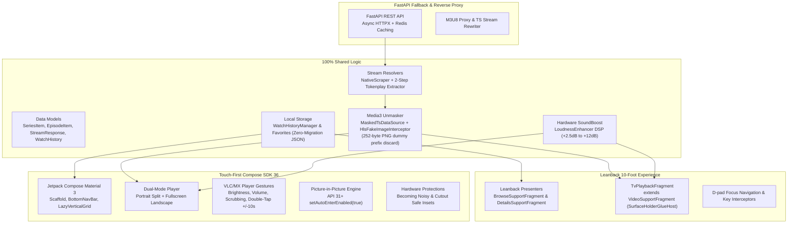

# 🏗️ StreamAppExpert Architecture Blueprint
## High-Performance Streaming Platform Architecture

---

## Shared vs Platform-Specific Separation Matrix

| Component | Android TV (`android/`) | Android Mobile (`android-mobile/`) | Backend Gateway (`backend/`) |
|---|---|---|---|
| **UI Framework** | AndroidX Leanback XML | Jetpack Compose Material 3 | FastAPI / Jinja2 (optional) |
| **Input System** | D-pad Remote DPAD Focus | Multi-touch Gestures & Tap | REST JSON API |
| **Video Surface** | `VideoSupportFragment` | `AndroidView(PlayerView)` | N/A |
| **Stream Engine** | Media3 ExoPlayer | Media3 ExoPlayer | HLS Reverse Proxy |
| **Unmasking** | `MaskedTsDataSource` | `MaskedTsDataSource` | M3U8 Rewriter |
| **Audio Boost** | `SoundBoostManager` | `SoundBoostManager` | N/A |
| **Target SDK** | 34-36 (TV) | 36 (Mobile Baklava) | Python 3.12+ |
| **Min SDK** | 21 (TV Android 5.0) | 26 (Mobile Android 8.0 Oreo) | N/A |
