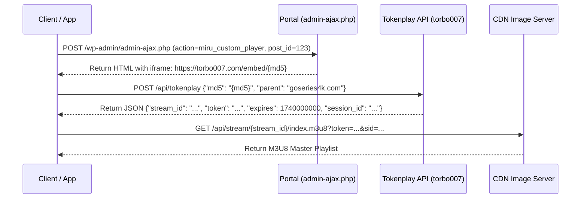

# 🎬 StreamAppExpert: The Comprehensive Streaming Engineering Playbook
## Hard-Won Insights, Root Cause Analyses & Production-Proven Solutions

This document serves as the master engineering reference for the `StreamAppExpert` multi-agent ecosystem. It documents real-world bugs, failure modes, root cause analyses, and battle-tested solutions encountered when building high-performance OTT, Android TV, and Android Mobile streaming applications.

---

## 📑 Table of Contents
1. [Bug 1: Android TV ExoPlayer Black Screen with Audio Working](#1-bug-1-android-tv-exoplayer-black-screen-with-audio-working)
2. [Bug 2: ExoPlayer Video Frozen on First Frame While Audio Plays (NAL Type 9 Bug)](#2-bug-2-exoplayer-video-frozen-on-first-frame-while-audio-plays-nal-type-9-bug)
3. [Bug 3: Disguised CDN Image Chunks (252-Byte Dummy PNG Header)](#3-bug-3-disguised-cdn-image-chunks-252-byte-dummy-png-header)
4. [Bug 4: Seeking/Scrubbing Stutter Caused by `Cache-Control: no-cache`](#4-bug-4-seekingscrubbing-stutter-caused-by-cache-control-no-cache)
5. [Enhancement 1: Hardware-Accelerated Audio Boost (LoudnessEnhancer)](#5-enhancement-1-hardware-accelerated-audio-boost-loudnessenhancer)
6. [Enhancement 2: VLC/MX Player-Style Mobile Gesture Controls](#6-enhancement-2-vlcmx-player-style-mobile-gesture-controls)
7. [Enhancement 3: Seamless Picture-in-Picture (PiP) Across Android 8.0 - 16](#7-enhancement-3-seamless-picture-in-picture-pip-across-android-80---16)
8. [Enhancement 4: Mobile Hardware Protections (Becoming Noisy & Cutout Insets)](#8-enhancement-4-mobile-hardware-protections-becoming-noisy--cutout-insets)
9. [Build & Packaging: Frictionless Sideloading Release APK with Debug Key](#9-build--packaging-frictionless-sideloading-release-apk-with-debug-key)
10. [Reverse Engineering: 2-Step Tokenplay HLS Stream Extraction Pipeline](#10-reverse-engineering-2-step-tokenplay-hls-stream-extraction-pipeline)

---

## 1. Bug 1: Android TV ExoPlayer Black Screen with Audio Working

### Symptoms
When playing HLS streams on Android TV using Leanback and Media3 ExoPlayer:
- Clear, crisp audio plays through speakers.
- Transport control timeline / progress bar advances normally.
- **Screen is 100% black; not a single video frame is displayed.**

### Root Cause Analysis
In AndroidX Leanback:
1. `PlaybackSupportFragment` is a base audio control fragment and **contains no `SurfaceView` or `TextureView` in its View hierarchy**.
2. The glue host (`PlaybackSupportFragmentGlueHost`) does not implement `SurfaceHolderGlueHost`.
3. When `LeanbackPlayerAdapter` attempts to link with the host:
   ```java
   if (mGlueHost instanceof SurfaceHolderGlueHost) {
       ((SurfaceHolderGlueHost) mGlueHost).setSurfaceHolderCallback(...);
   }
   ```
   The check evaluates to `false`. ExoPlayer's `setVideoSurface()` is never called.
4. The MediaCodec hardware decoder decodes H.264/H.265 frames into memory, but has nowhere to render them.

### Verified Fix
1. Subclass **`VideoSupportFragment`** instead of `PlaybackSupportFragment`.
2. Connect `VideoSupportFragmentGlueHost(this)` which fully implements `SurfaceHolderGlueHost`.
3. Explicitly link `surfaceView` directly upon fragment creation:
   ```kotlin
   surfaceView?.let { exoPlayer.setVideoSurfaceView(it) }
   ```

---

## 2. Bug 2: ExoPlayer Video Frozen on First Frame While Audio Plays (NAL Type 9 Bug)

### Symptoms
- Initial frame renders correctly, or seeking to a new position updates to a new still frame.
- However, **video never moves; it remains permanently frozen on a single still image**.
- Audio plays smoothly in real-time.

### Root Cause Analysis
- Many video CDNs (e.g. TikTok CDN / ByteDance ImageX) encode H.264 video with an explicit **NAL Type 9 (AUD - Access Unit Delimiter)** before every slice.
- When configuring `DefaultHlsExtractorFactory`, developers often pass:
  ```kotlin
  DefaultTsPayloadReaderFactory.FLAG_DETECT_ACCESS_UNITS
  ```
- This flag forces `H264Reader` to discard natural AUD boundaries and attempt to parse raw slice headers.
- On these CDN streams, slice parsing fails, causing `H264Reader` to **silently discard all 232 non-IDR (P and B) frames per segment**, outputting only the single initial IDR keyframe to the video decoder.

### Verified Fix
ALWAYS use the default `DefaultHlsExtractorFactory()` constructor with `flags = 0`. Let ExoPlayer use the stream's native AUD delimiters:
```kotlin
val hlsExtractorFactory = DefaultHlsExtractorFactory() // flags = 0
```

---

## 3. Bug 3: Disguised CDN Image Chunks (252-Byte Dummy PNG Header)

### Symptoms
ExoPlayer throws `UnrecognizedInputFormatException` or `ParserException: None of the available extractors could read the stream` when fetching `.image` or `.png` URLs.

### Root Cause Analysis
Streaming platforms disguise MPEG-TS video chunks as images to exploit aggressive edge caching (`max-age=31536000`).
They prepend a **252-byte dummy PNG header** (`89 50 4E 47 ...`) to the segment:
- Bytes `0 - 251`: Dummy 1x1 pixel PNG file.
- Byte `252` onwards: Pure MPEG-TS transport stream starting with sync byte `0x47` and PAT packet header `47 40 00 10` (PID 0), repeating in 188-byte strides.

### Verified Fix
Create a custom `MaskedTsDataSource` wrapping `DefaultHttpDataSource`:
1. Check if URI matches disguised pattern (`.image`, `.png`, `tiktokcdn`).
2. Read the first 252 bytes. If the 8-byte PNG magic matches, **discard all 252 bytes**.
3. Feed the remainder directly into `TsExtractor`.

---

## 4. Bug 4: Seeking/Scrubbing Stutter Caused by `Cache-Control: no-cache`

### Symptoms
When user scrubs the timeline or presses ±10s seek, video buffers for 3-5 seconds and stutters heavily, even on fast internet connections.

### Root Cause Analysis
Developers attempting to bypass CDN caching often insert `Cache-Control: no-cache, no-store` inside an OkHttp interceptor.
However:
1. The CDN has already cached the segment on edge servers; client headers do not change upstream CDN behavior.
2. But ExoPlayer and OkHttp respect client cache headers: forcing `no-cache` forbids caching segments in device memory/disk!
3. During timeline scrubbing, ExoPlayer is forced to re-download identical chunks over the network instead of pulling from local buffer cache.

### Verified Fix
**NEVER mutate `Cache-Control` on media responses.** Retain `max-age=31536000` from origin CDN. Only modify `Content-Type: video/mp2t`.

---

## 5. Enhancement 1: Hardware-Accelerated Audio Boost (LoudnessEnhancer)

### Problem
Online streaming web-rips frequently feature whisper-quiet dialogue mastered at -20dB to -24dB LUFS. Software multipliers cause clipping distortion.

### Verified Solution
Attach Android's native DSP `LoudnessEnhancer` to the ExoPlayer `audioSessionId`:
```kotlin
val enhancer = LoudnessEnhancer(exoPlayer.audioSessionId).apply {
    setTargetGain(500) // +5.0 dB boost
    enabled = true
}
```
Provides clean, transparent dialogue lift up to +12dB with zero digital distortion.

---

## 6. Enhancement 2: VLC/MX Player-Style Mobile Gesture Controls

### Implementation Principles
1. **Vertical Left Swipe**: Screen brightness via `WindowManager.LayoutParams.screenBrightness`.
2. **Vertical Right Swipe**: Media stream volume via `AudioManager.STREAM_MUSIC`.
3. **Horizontal Swipe**: Fast seek scrubbing preview with target time display.
4. **Double-Tap Left / Right**: Instant ±10s seek with animated visual ripple pill.
5. **Screen Lock Button**: Completely locks all gesture and HUD listeners to prevent palm mis-touches in bed or on transit.

---

## 7. Enhancement 3: Seamless Picture-in-Picture (PiP) Across Android 8.0 - 16

### Implementation Principles
- Target `minSdk = 26` (Android 8.0 Oreo), `targetSdk = 36` (Android 16 Baklava).
- On Android 12+ (API 31+), enable `setAutoEnterEnabled(true)` on `PictureInPictureParams`.
- Enforce Rational aspect ratio within system limits (`0.41841f .. 2.39f`).
- During PiP mode, hide all control chrome and status bars to render only the clean video surface.

---

## 8. Enhancement 4: Mobile Hardware Protections (Becoming Noisy & Cutout Insets)

### 1. Becoming Noisy
Intercept `AudioManager.ACTION_AUDIO_BECOMING_NOISY` broadcast receiver. When Bluetooth earbuds run out of battery or 3.5mm jack is unplugged, automatically pause video to prevent loud speaker output.

### 2. Display Cutout Insets
Configure `layoutInDisplayCutoutMode = SHORT_EDGES` and apply `windowInsetsPadding(WindowInsets.displayCutout)` so video controls never render underneath camera punch-holes.

---

## 9. Build & Packaging: Frictionless Sideloading Release APK with Debug Key

### Requirements
- End users sideload streaming APKs onto TV boxes and mobile devices.
- Managing production keystores creates build friction and sideload signature mismatches.

### Verified Solution
Configure release buildType in `app/build.gradle.kts`:
```kotlin
buildTypes {
    release {
        isMinifyEnabled = true
        isShrinkResources = true
        signingConfig = signingConfigs.getByName("debug")
        proguardFiles(getDefaultProguardFile("proguard-android-optimize.txt"), "proguard-rules.pro")
    }
}
```
Enforce R8 fullMode, ProGuard stripping, and resource shrinking (`resConfigs("th", "en")`) to keep APK size ultra-lean (< 12MB).

---

## 10. Reverse Engineering: 2-Step Tokenplay HLS Stream Extraction Pipeline

### Extraction Flow

- Validate session with `GET /api/v2/stream/{md5}?parent={parent}&_={timestamp}` if initial token request is rate-limited.
- Set correct `Origin`, `Referer`, and `X-Requested-With` headers on all requests.
