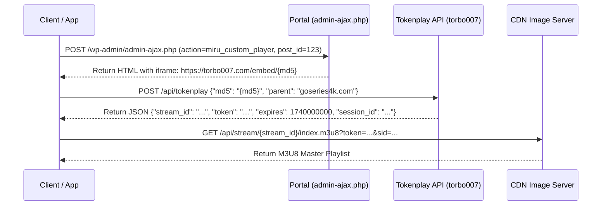

# 🎬 StreamAppExpert: The Comprehensive Streaming Engineering Playbook
## Hard-Won Insights, Root Cause Analyses & Production-Proven Solutions

This document serves as the master engineering reference for the `StreamAppExpert` multi-agent ecosystem. It documents real-world bugs, failure modes, root cause analyses, and battle-tested solutions encountered when building high-performance OTT, Android TV, and Android Mobile streaming applications.

---

## 📑 Table of Contents
1. [Bug 1: Android TV ExoPlayer Black Screen with Audio Working](#1-bug-1-android-tv-exoplayer-black-screen-with-audio-working)
2. [Bug 2: ExoPlayer Video Frozen on First Frame While Audio Plays (NAL Type 9 Bug)](#2-bug-2-exoplayer-video-frozen-on-first-frame-while-audio-plays-nal-type-9-bug)
3. [Bug 3: Disguised CDN Image Chunks (252-Byte Dummy PNG Header)](#3-bug-3-disguised-cdn-image-chunks-252-byte-dummy-png-header)
4. [Bug 4: Seeking/Scrubbing Stutter Caused by `Cache-Control: no-cache`](#4-bug-4-seekingscrubbing-stutter-caused-by-cache-control-no-cache)
5. [Audio Amplification: Safe Software Scaling vs LoudnessEnhancer TV Crash](#5-audio-amplification-safe-software-scaling-vs-loudnessenhancer-tv-crash)
6. [Enhancement 1: VLC/MX Player-Style Mobile Gesture Controls](#6-enhancement-1-vlcmx-player-style-mobile-gesture-controls)
7. [Enhancement 2: Seamless Picture-in-Picture (PiP) Across Android 8.0 - 16](#7-enhancement-2-seamless-picture-in-picture-pip-across-android-80---16)
8. [Enhancement 3: Mobile Hardware Protections (Becoming Noisy & Cutout Insets)](#8-enhancement-3-mobile-hardware-protections-becoming-noisy--cutout-insets)
9. [Build & Packaging: Frictionless Sideloading Release APK with Debug Key](#9-build--packaging-frictionless-sideloading-release-apk-with-debug-key)
10. [Reverse Engineering: 2-Step Tokenplay HLS Stream Extraction Pipeline](#10-reverse-engineering-2-step-tokenplay-hls-stream-extraction-pipeline)
11. [Bug 5: Expired Presigned CDN Tokens in Watch History (HTTP 403 Forbidden)](#11-bug-5-expired-presigned-cdn-tokens-in-watch-history-http-403-forbidden)
12. [Bug 6: Android 14+ (SDK 34-36) Fatal Crash on `registerReceiver` without `RECEIVER_NOT_EXPORTED`](#12-bug-6-android-14-sdk-34-36-fatal-crash-on-registerreceiver-without-receiver_not_exported)
13. [Bug 7: Screen Orientation Lock Failure: Sensor Overriding Custom Fullscreen HUD](#13-bug-7-screen-orientation-lock-failure-sensor-overriding-custom-fullscreen-hud)
14. [Bug 8: Compose Infinite Scroll / Pagination Duplicate Key Crash](#14-bug-8-compose-infinite-scroll--pagination-duplicate-key-crash)
15. [Bug 9: Brittle Video Embed Regex Matching vs Semantic `<script id="watch-config">`](#15-bug-9-brittle-video-embed-regex-matching-vs-semantic-script-idwatch-config)
16. [Bug 10: Video Card Blank Cover Image Caused by `.mp4` Preview Attribute Collision](#16-bug-10-video-card-blank-cover-image-caused-by-mp4-preview-attribute-collision)
17. [Bug 11: Compose Material 3 Icon Button Missing `sizeIn(48.dp)` Causing Misclicks](#17-bug-11-compose-material-3-icon-button-missing-sizein48dp-causing-misclicks)
18. [Bug 12: Hardware LoudnessEnhancer TV Chipset Crash (AudioFlinger Reject)](#18-bug-12-hardware-loudnessenhancer-tv-chipset-crash-audioflinger-reject)

---

## 1. Bug 1: Android TV ExoPlayer Black Screen with Audio Working

### Symptoms
When playing HLS streams on Android TV using Leanback and Media3 ExoPlayer:
- Clear, crisp audio plays through speakers.
- Transport control timeline / progress bar advances normally.
- **Screen is 100% black; not a single video frame is displayed.**

### Root Cause Analysis
In AndroidX Leanback:
1. `PlaybackSupportFragment` is a base audio control fragment and **contains no `SurfaceView` or `TextureView` in its View hierarchy**.
2. The glue host (`PlaybackSupportFragmentGlueHost`) does not implement `SurfaceHolderGlueHost`.
3. When `LeanbackPlayerAdapter` attempts to link with the host:
   ```java
   if (mGlueHost instanceof SurfaceHolderGlueHost) {
       ((SurfaceHolderGlueHost) mGlueHost).setSurfaceHolderCallback(...);
   }
   ```
   The check evaluates to `false`. ExoPlayer's `setVideoSurface()` is never called.
4. The MediaCodec hardware decoder decodes H.264/H.265 frames into memory, but has nowhere to render them.

### Verified Fix
1. Subclass **`VideoSupportFragment`** instead of `PlaybackSupportFragment`.
2. Connect `VideoSupportFragmentGlueHost(this)` which fully implements `SurfaceHolderGlueHost`.
3. Explicitly link `surfaceView` directly upon fragment creation:
   ```kotlin
   surfaceView?.let { exoPlayer.setVideoSurfaceView(it) }
   ```

---

## 2. Bug 2: ExoPlayer Video Frozen on First Frame While Audio Plays (NAL Type 9 Bug)

### Symptoms
- Initial frame renders correctly, or seeking to a new position updates to a new still frame.
- However, **video never moves; it remains permanently frozen on a single still image**.
- Audio plays smoothly in real-time.

### Root Cause Analysis
- Many video CDNs (e.g. TikTok CDN / ByteDance ImageX) encode H.264 video with an explicit **NAL Type 9 (AUD - Access Unit Delimiter)** before every slice.
- When configuring `DefaultHlsExtractorFactory`, developers often pass:
  ```kotlin
  DefaultTsPayloadReaderFactory.FLAG_DETECT_ACCESS_UNITS
  ```
- This flag forces `H264Reader` to discard natural AUD boundaries and attempt to parse raw slice headers.
- On these CDN streams, slice parsing fails, causing `H264Reader` to **silently discard all 232 non-IDR (P and B) frames per segment**, outputting only the single initial IDR keyframe to the video decoder.

### Verified Fix
ALWAYS use the default `DefaultHlsExtractorFactory()` constructor with `flags = 0`. Let ExoPlayer use the stream's native AUD delimiters:
```kotlin
val hlsExtractorFactory = DefaultHlsExtractorFactory() // flags = 0
```

---

## 3. Bug 3: Disguised CDN Image Chunks (252-Byte Dummy PNG Header)

### Symptoms
ExoPlayer throws `UnrecognizedInputFormatException` or `ParserException: None of the available extractors could read the stream` when fetching `.image` or `.png` URLs.

### Root Cause Analysis
Streaming platforms disguise MPEG-TS video chunks as images to exploit aggressive edge caching (`max-age=31536000`).
They prepend a **252-byte dummy PNG header** (`89 50 4E 47 ...`) to the segment:
- Bytes `0 - 251`: Dummy 1x1 pixel PNG file.
- Byte `252` onwards: Pure MPEG-TS transport stream starting with sync byte `0x47` and PAT packet header `47 40 00 10` (PID 0), repeating in 188-byte strides.

### Verified Fix
Create a custom `MaskedTsDataSource` wrapping `DefaultHttpDataSource`:
1. Check if URI matches disguised pattern (`.image`, `.png`, `tiktokcdn`).
2. Read the first 252 bytes. If the 8-byte PNG magic matches, **discard all 252 bytes**.
3. Feed the remainder directly into `TsExtractor`.

---

## 4. Bug 4: Seeking/Scrubbing Stutter Caused by `Cache-Control: no-cache`

### Symptoms
When user scrubs the timeline or presses ±10s seek, video buffers for 3-5 seconds and stutters heavily, even on fast internet connections.

### Root Cause Analysis
Developers attempting to bypass CDN caching often insert `Cache-Control: no-cache, no-store` inside an OkHttp interceptor.
However:
1. The CDN has already cached the segment on edge servers; client headers do not change upstream CDN behavior.
2. But ExoPlayer and OkHttp respect client cache headers: forcing `no-cache` forbids caching segments in device memory/disk!
3. During timeline scrubbing, ExoPlayer is forced to re-download identical chunks over the network instead of pulling from local buffer cache.

### Verified Fix
**NEVER mutate `Cache-Control` on media responses.** Retain `max-age=31536000` from origin CDN. Only modify `Content-Type: video/mp2t`.

---

## 5. Audio Amplification: Safe Software Scaling vs LoudnessEnhancer TV Crash

### Problem
Online streaming web-rips frequently feature whisper-quiet dialogue mastered at -20dB to -24dB LUFS.

### Critical Production Caveat (Android TV Crash)
While `LoudnessEnhancer(exoPlayer.audioSessionId)` works on mobile devices, **attaching hardware LoudnessEnhancer on Android TV chipsets (Amlogic S905X4, ZTE B866V2K, Realtek RTD2871) causes fatal playback failure**:
1. When streaming HLS variants with multi-audio tracks or passthrough codecs (E-AC-3/AC-3/AAC passthrough), the native ALSA AudioFlinger rejects AudioEffect attachment.
2. ExoPlayer throws `IllegalStateException: AudioTrack.write() failed` or `ERROR_CODE_AUDIO_TRACK_WRITE_FAILED`.
3. The player enters an infinite rebuffering loop.

### Verified Production Fix (Iron Law)
**Default to Safe Linear Software Scaling directly via `exoPlayer.volume`** (1.0x to 2.4x):
```kotlin
fun setAudioBoost(player: ExoPlayer, level: BoostLevel) {
    val multiplier = when (level) {
        BoostLevel.OFF -> 1.0f      // 100% (Reference)
        BoostLevel.LOW -> 1.35f     // 150% (+2.6 dB lift)
        BoostLevel.MEDIUM -> 1.65f  // 200% (+4.3 dB dialogue boost)
        BoostLevel.HIGH -> 2.00f    // 250% (+6.0 dB heavy boost)
        BoostLevel.MAX -> 2.40f     // 300% (+7.6 dB max ceiling, zero clipping)
    }
    player.volume = multiplier
}
```
*For deep dive analysis, see `techdocs/CASE_STUDY_AUDIO_BOOST_TV_CRASH.md`.*

---

## 6. Enhancement 2: VLC/MX Player-Style Mobile Gesture Controls

### Implementation Principles
1. **Vertical Left Swipe**: Screen brightness via `WindowManager.LayoutParams.screenBrightness`.
2. **Vertical Right Swipe**: Media stream volume via `AudioManager.STREAM_MUSIC`.
3. **Horizontal Swipe**: Fast seek scrubbing preview with target time display.
4. **Double-Tap Left / Right**: Instant ±10s seek with animated visual ripple pill.
5. **Screen Lock Button**: Completely locks all gesture and HUD listeners to prevent palm mis-touches in bed or on transit.

---

## 7. Enhancement 3: Seamless Picture-in-Picture (PiP) Across Android 8.0 - 16

### Implementation Principles
- Target `minSdk = 26` (Android 8.0 Oreo), `targetSdk = 36` (Android 16 Baklava).
- On Android 12+ (API 31+), enable `setAutoEnterEnabled(true)` on `PictureInPictureParams`.
- Enforce Rational aspect ratio within system limits (`0.41841f .. 2.39f`).
- During PiP mode, hide all control chrome and status bars to render only the clean video surface.

---

## 8. Enhancement 4: Mobile Hardware Protections (Becoming Noisy & Cutout Insets)

### 1. Becoming Noisy
Intercept `AudioManager.ACTION_AUDIO_BECOMING_NOISY` broadcast receiver. When Bluetooth earbuds run out of battery or 3.5mm jack is unplugged, automatically pause video to prevent loud speaker output.

### 2. Display Cutout Insets
Configure `layoutInDisplayCutoutMode = SHORT_EDGES` and apply `windowInsetsPadding(WindowInsets.displayCutout)` so video controls never render underneath camera punch-holes.

---

## 9. Build & Packaging: Frictionless Sideloading Release APK with Debug Key

### Requirements
- End users sideload streaming APKs onto TV boxes and mobile devices.
- Managing production keystores creates build friction and sideload signature mismatches.

### Verified Solution
Configure release buildType in `app/build.gradle.kts`:
```kotlin
buildTypes {
    release {
        isMinifyEnabled = true
        isShrinkResources = true
        signingConfig = signingConfigs.getByName("debug")
        proguardFiles(getDefaultProguardFile("proguard-android-optimize.txt"), "proguard-rules.pro")
    }
}
```
Enforce R8 fullMode, ProGuard stripping, and resource shrinking (`resConfigs("th", "en")`) to keep APK size ultra-lean (< 12MB).

---

## 10. Reverse Engineering: 2-Step Tokenplay HLS Stream Extraction Pipeline

### Extraction Flow

- Validate session with `GET /api/v2/stream/{md5}?parent={parent}&_={timestamp}` if initial token request is rate-limited.
- Set correct `Origin`, `Referer`, and `X-Requested-With` headers on all requests.

---

## 11. Bug 5: Expired Presigned CDN Tokens in Watch History (HTTP 403 Forbidden)

### Symptoms
User plays a movie today, stops midway, and sees it saved in "Watch History". The next morning, opening that movie fails with `403 Forbidden: Request has expired` or an infinite loading spinner.

### Root Cause Analysis
Modern CDNs (Cloudflare R2, AWS S3, Javtiful) use presigned URLs with query parameters:
`?expires=1731590400&signature=...` (typically 1 hour / 3600s TTL).
Saving the resolved playback stream URL into Room DB / SharedPreferences persists an expiring temporary URL. When the user resumes playback hours or days later, the CDN edge node rejects the request with HTTP 403.

### Verified Fix (Dynamic Token Resolution Protocol)
1. **Store Canonical Content References**: Only store permanent content identifiers (`videoId` or canonical web URL `/video/xyz`) in Watch History and Bookmarks.
2. **Proactive Expiration Check**:
   ```kotlin
   fun isStreamUrlExpired(url: String, bufferSeconds: Long = 300L): Boolean {
       val uri = Uri.parse(url)
       val expiresStr = uri.getQueryParameter("expires") 
           ?: uri.getQueryParameter("X-Amz-Expires")
       val expiresAt = expiresStr?.toLongOrNull() ?: return false
       return (System.currentTimeMillis() / 1000L) >= (expiresAt - bufferSeconds)
   }
   ```
3. **Dynamic Re-resolution**:
   When launching the player from history, if `isStreamUrlExpired(streamUrl)` is true, or if `streamUrl` is blank, resolve a fresh ticket via `POST /video/{id}/playback` in ~0.5s.
4. **Auto-Healing `onPlayerError`**: If ExoPlayer encounters `ERROR_CODE_IO_BAD_HTTP_STATUS` (HTTP 401/403), asynchronously re-resolve the token and resume at `player.currentPosition`.

---

## 12. Bug 6: Android 14+ (SDK 34-36) Fatal Crash on `registerReceiver` without `RECEIVER_NOT_EXPORTED`

### Symptoms
App immediately crashes on Android 14+ (API 34/35/36) when launching the player:
`java.lang.SecurityException: com.example.app: One of RECEIVER_EXPORTED or RECEIVER_NOT_EXPORTED should be specified when a receiver isn't being registered exclusively for system broadcasts`

### Root Cause Analysis
Starting in Android 14 (API 34) and strictly enforced in Target SDK 36 (Android 16), all contextual broadcast receivers registered via `registerReceiver()` MUST explicitly specify either `RECEIVER_EXPORTED` or `RECEIVER_NOT_EXPORTED`.
Calling `context.registerReceiver(receiver, filter)` without flags throws a fatal `SecurityException`.

### Verified Fix
Always use `ContextCompat.registerReceiver` with `ContextCompat.RECEIVER_NOT_EXPORTED`:
```kotlin
ContextCompat.registerReceiver(
    context,
    receiver,
    IntentFilter(AudioManager.ACTION_AUDIO_BECOMING_NOISY),
    ContextCompat.RECEIVER_NOT_EXPORTED
)
```

---

## 13. Bug 7: Screen Orientation Lock Failure: Sensor Overriding Custom Fullscreen HUD

### Symptoms
In portrait mode, user taps the Fullscreen button. The HUD rotates to landscape. However, when the user tilts the device slightly or rotates to portrait, the screen auto-rotates back to portrait or ignores user intent.

### Root Cause Analysis
Merely toggling internal layout states (`isFullscreen = true`) does not lock the underlying Android WindowManager orientation. If `requestedOrientation` is left as `SCREEN_ORIENTATION_UNSPECIFIED`, the hardware accelerometer overrides the app.
Conversely, setting `SCREEN_ORIENTATION_LANDSCAPE` locks the device to a single fixed landscape orientation and breaks 180° reverse landscape (when charging cable is on the opposite side).

### Verified Fix
1. On Enter Fullscreen:
   `activity.requestedOrientation = ActivityInfo.SCREEN_ORIENTATION_SENSOR_LANDSCAPE` (enables both landscape angles, strictly locks out portrait).
2. On Exit Fullscreen:
   `activity.requestedOrientation = ActivityInfo.SCREEN_ORIENTATION_PORTRAIT`, followed by `ActivityInfo.SCREEN_ORIENTATION_UNSPECIFIED`.
3. Intercept Hardware Back:
   ```kotlin
   BackHandler(enabled = isFullscreen) {
       onExitFullscreen() // Restores portrait before navigating back
   }
   ```

---

## 14. Bug 8: Compose Infinite Scroll / Pagination Duplicate Key Crash

### Symptoms
Scrolling down to the bottom of the Home screen or Search Results grid causes an instant crash:
`java.lang.IllegalArgumentException: Key "video-1024" was already used. If you are using LazyColumn/Row please make sure you provide an unique key for each item.`

### Root Cause Analysis
1. Modern streaming portal backends often return overlapping items when page items shift between scrapes or when pagination offsets overlap.
2. In Compose `LazyVerticalGrid(key = { it.id })`, duplicate keys in the composition tree violate Compose invariant constraints, crashing the entire UI thread.

### Verified Fix (Defense-in-Depth)
1. **ViewModel Deduplication**:
   ```kotlin
   val current = (_uiState.value as? HomeUiState.Success)?.videos.orEmpty()
   val merged = (current + newVideos).distinctBy { it.id }
   _uiState.update { HomeUiState.Success(merged) }
   ```
2. **Composite UI Keys**:
   ```kotlin
   items(
       count = videos.size,
       key = { index -> "${videos[index].id}_$index" }
   ) { index ->
       VideoCard(videos[index])
   }
   ```

---

## 15. Bug 9: Brittle Video Embed Regex Matching vs Semantic `<script id="watch-config">`

### Symptoms
App fails to extract video streams, showing "Stream not found" or black screen. Web browser plays video smoothly.

### Root Cause Analysis
Developers frequently write rigid regular expressions matching multi-line JSON structures:
`Regex("""sources:\s*\[\{\s*file:\s*"([^"]+)"""")`
Any minification, newline change, attribute reordering, or CDN config restructuring breaks the regex entirely.

### Verified Fix
1. **Fast Direct Playback API**: Probe for `POST /video/{id}/playback` first (~0.5s response, zero DOM parsing).
2. **Semantic Script Extraction**: If scraping HTML, select the structured script tag and parse with `JSONObject`:
   ```kotlin
   val script = doc.selectFirst("script#watch-config, script#__NEXT_DATA__")
   if (script != null) {
       val json = JSONObject(script.data())
       val streamUrl = json.optJSONObject("player")?.optString("source")
   }
   ```
3. **Referer Auto-Healing**: When CDN serves streams across multiple domains, pass the portal base URL as `Referer` and `Origin` in OkHttp headers.

---

## 16. Bug 10: Video Card Blank Cover Image Caused by `.mp4` Preview Attribute Collision

### Symptoms
Video thumbnail cards on the Home screen display a blank grey card or failed image placeholder.

### Root Cause Analysis
Streaming sites place both a static poster image (`data-front-lazy-src="poster.jpg"`) and an animated preview clip (`data-preview-src="clip.mp4"`) on the same `` tag.
Scrapers taking the first matching attribute ending in `.mp4` pass the video URL to Coil/Glide image loaders, which fail to render MP4 as a static bitmap.

### Verified Fix
Explicitly exclude `.mp4` preview URLs and prioritize static image attributes:
```kotlin
val posterUrl = listOf(
    img.attr("data-front-lazy-src"),
    img.attr("data-src"),
    img.attr("src")
).firstOrNull { it.isNotBlank() && !it.endsWith(".mp4", ignoreCase = true) }
```

---

## 17. Bug 11: Compose Material 3 Icon Button Missing `sizeIn(48.dp)` Causing Misclicks

### Symptoms
Users on touchscreens fail to tap the Lock, PiP, or Fullscreen buttons during playback, or accidentally trigger playback scrub gestures instead.

### Root Cause Analysis
Material 3 `IconButton` has a default touch target, but when nested inside customized player control bars with small icon sizes (`size(24.dp)`), the minimum interactive bounding box can be clipped.

### Verified Fix
Explicitly enforce `sizeIn(minWidth = 48.dp, minHeight = 48.dp)` on all interactive player overlay icons:
```kotlin
IconButton(
    onClick = onToggleLock,
    modifier = Modifier.sizeIn(minWidth = 48.dp, minHeight = 48.dp)
) {
    Icon(imageVector = Icons.Default.Lock, contentDescription = "Lock Screen")
}
```

---

## 18. Bug 12: Hardware LoudnessEnhancer TV Chipset Crash (AudioFlinger Reject)

### Symptoms
Audio boost works on phones, but on Android TV boxes (Amlogic, Realtek, ZTE), enabling audio boost causes immediate audio freeze, `IllegalStateException: AudioTrack.write() failed`, and an infinite buffering spinner.

### Root Cause Analysis
Android TV devices pass audio directly to external soundbars or HDMI receivers via hardware passthrough. The native AudioFlinger rejects software audio effects on these tracks.

### Verified Fix
Use **Safe Linear Software Volume Scaling directly on `exoPlayer.volume`** (1.0x to 2.4x):
```kotlin
player.volume = 1.65f // +4.3 dB dialogue boost with zero hardware effect risk
```
*Full architectural post-mortem: `techdocs/CASE_STUDY_AUDIO_BOOST_TV_CRASH.md`.*
